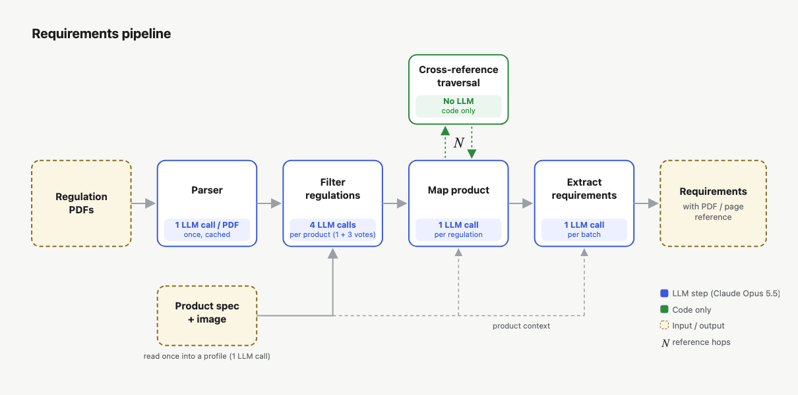

# certivity-hack

Team-05's pipeline for the Certivity industrial AI hackathon. Given a product (a specification and an exploded-view
image) and a library of UNECE regulations, it produces the list of engineering requirements that bind the product,
each traced back to its regulation, version, page and paragraph.



## How it works

1. **Parser.** Regulation PDFs are parsed into paragraph nodes (label, hierarchy, page, tables as markdown grids) and
   each regulation gets a summary card (scope, defined terms, classes, which sections cover what). This runs once per
   PDF and is cached in `data/pdf/` and `data/regcards/`.
2. **Product profile.** The specification is parsed and the exploded view is read with Claude vision.
3. **Filter regulations.** One screening call scores every regulation card against the product (plus supersession
   rules and a BM25 safety net), then three shuffled re-check calls vote on each candidate's role for the product. Code
   keeps a regulation when the product is the regulated device, the installation subject, the main carrier of the topic
   or brings electronics on board, at least one product part links to a defined term, and the mean probability is
   at least 0.5.
4. **Map product.** One call per candidate regulation maps product parts to the regulation's defined terms and classes
   and lists the open options the specification leaves undecided.
5. **Extract requirements.** Each kept regulation is read whole, in batches of about 40k characters, with the product
   context. One call per batch returns many requirements, each citing the paragraph(s) it is stated in.
6. **Cross-reference traversal.** Code only: follows paragraph, annex and table references (N hops), parent clauses and
   definitions, and attaches them to each requirement as context. It never creates requirements.

## LLM calls

| Step | Calls |
|---|---|
| Parser (summary card) | 1 per PDF, once, cached |
| Product profile | 1 per product |
| Filter regulations | 1 + 3 votes per product |
| Map product | 1 per candidate regulation |
| Extract requirements | 1 per ~40k-character batch of each kept regulation |
| Cross-reference traversal | 0 (code) |

Every call goes through `pipeline.call_json` (model `claude-opus-5-5`, structured JSON output) and is cached on disk by
a hash of its input, so re-running an unchanged step is free.

## Running a case

```bash
./run_case.sh <case_dir> <selection.json> <profile.json> <name> [team]
# e.g. PROMPT=v8 ./run_case.sh ../industrial-ai-hackathon/cases/heldout-front-bumper \
#        runs/<run>/selection.json runs/<run>/profile.json bumper
```

`run_case.sh` runs `stage_a2.py` (re-check), then one `c1full.py` process per kept regulation in parallel, then
`c1full_submit.py`, and writes `runs/submission-<name>/submission.json`. The screening and mapping
(`selection.json`) come from `hybrid7.py` / `bbpipe.py`, the profile from `profile.py`. The extraction prompt version
is set with `PROMPT` (default `v7`; `v8` and `v9` are defined in `c1full.py`).

Setup the script expects: this repo next to a clone of `industrial-ai-hackathon` (cases and regulations), a `.env`
with `ANTHROPIC_API_KEY` and a Python virtualenv `.venv` in the parent directory, with `anthropic`, `pymupdf`,
`pymupdf4llm` and `rapidfuzz` installed.

## Repository layout

| Path | What |
|---|---|
| `run_case.sh` | Final pipeline for one case |
| `src/regparse.py`, `src/regcards.py` | PDF parsing and regulation cards |
| `src/profile.py`, `src/extend_profile.py` | Product profile |
| `src/hybrid.py`, `src/hybrid7.py`, `src/bbpipe.py` | Screening (stage A) and product mapping (stage B) |
| `src/stage_a2.py` | Regulation re-check with voting |
| `src/c1full.py` | Batched extraction and context traversal |
| `src/traverse.py` | Reference traversal from selected sections |
| `src/c1full_submit.py` | Merges per-regulation runs into one submission |
| `src/judge.py`, `src/evaluate.py`, `src/c1full_eval.py` | Scoring against expected answers |
| `src/subgoal.py`, `src/subgoal_bench.py` | Sub-goal: requirement changes between regulation versions |
| `data/` | Parsed regulations, regulation cards, product profiles |
| `runs/`, `submissions/` | Run outputs and submitted files |
| `artifacts/`, `notes/` | Design notes |

## Results

Reported as F2 (recall weighted 4x over precision) and recall.

| Case | Submission | F2 | Recall | Scope |
|---|---|---|---|---|
| Front bumper (held-out), final | `submissions/final_submission.json` | 72.7% | 80.8% | Platform score, whole case. v8 output post-filtered by pages and cross-run agreement; the page selection used feedback from earlier platform uploads, so this score is partly tuned on the held-out case. The post-filter is not in `run_case.sh`. |
| Front bumper (held-out) | `submissions/heldout-front-bumper_v8_F2-0.688.json`, prompt v8 | 68.8% | 85.1% | Platform score, whole case, 7/7 regulations; `run_case.sh` output |
| Rear lamp (dev) | prompt v8 | 70.1% | 85.8% | Our judge, whole case; prompts were tuned on this case |
